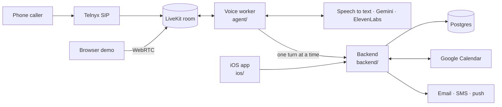

# AI Voice Receptionist

An AI phone receptionist for small practices (doctors, dentists, physios, vets, barbers, beauty clinics, garages), built Greek-first with English on request. It answers the phone, answers questions about the business, books, moves and cancels appointments, takes messages and hands the caller to a person when needed. Staff follow every call from an iOS app.

> **Status:** pilot. The features are built and covered by tests and evals; live acceptance (real phone lines, handoffs, a recording notice) is done per deployment.

## How it works



| Part | Does | Never does |
|---|---|---|
| **Voice worker** (`agent/`, LiveKit Agents) | Listens, decides when the caller has finished, speaks, and runs safety checks on the caller's words (emergency phrases, language switch) | Work out dates, free times or bookings |
| **Backend** (`backend/`, FastAPI) | Runs the conversation as a state machine and owns every decision: routing rules, dates, free slots, booking under a lock, readbacks, notifications, summaries, costs | Talk to the caller |
| **iOS app** (`ios/`, SwiftUI) | Shows staff the calls, transcripts, recordings, appointments, messages and metrics, and lets them join a live call | Talk to the model providers |

The rule that runs through the code: **the model only reports what the caller said; the backend decides what is true.** Each caller turn is one model call that writes its reading of the turn (intent, day, time, name…) and a natural reply. The backend merges that into the call's state and either speaks its own sentence (offers, the readback, «booked») or lets the model's reply through for small talk and questions. Nothing is booked, moved or cancelled without a readback from the backend and the caller's own clear yes, and only times the backend offered can be booked.

Details, with the reasons behind each choice: [docs/architecture.md](docs/architecture.md).

## Repository layout

```text
agent/                 LiveKit voice worker (Python)
  agent.py             engines, turn handling, the state-machine client, the tool flow
  providers/           speech to text, language model and voice for each engine
  speech.py            pronunciation (Greek times in words), delivery settings
  fixed_lines.py       greeting and goodbye, voiced in advance and cached
  telemetry.py         content-free timing and usage events
  evals/               text evals that pass or fail on database state
  scripts/             scripted audio calls, synthetic monitoring calls
backend/               FastAPI service
  app/flow.py          the conversation state machine
  app/receptionist.py  call start and every agent tool
  app/booking.py       spoken dates, free slots, book / move / cancel
  app/routing.py       routing rules, emergency, off-topic, handoff
  app/scheduler.py     digests, reminders, retention, health checks
  app/routers/         REST API, web demo, live monitor
  config/              prompts (el, en), business-type templates, prices
  alembic/             schema baseline and migrations
  tests/               unit and Postgres integration tests
ios/                   SwiftUI staff app (XcodeGen)
docs/                  architecture, call routing, evals, telemetry, web demo
```

## Running locally

Requirements: Python 3.12 and [uv](https://docs.astral.sh/uv/), Docker, and keys for LiveKit Cloud, Gemini and ElevenLabs (plus Telnyx for real phone calls). Xcode and XcodeGen for the app.

```bash
cp .env.example .env               # fill it in; use long random values for the three API tokens
docker compose up -d postgres

cd backend
uv run --python 3.12 --env-file ../.env --with-requirements requirements.txt alembic upgrade head
uv run --python 3.12 --env-file ../.env --with-requirements requirements.txt uvicorn app.main:app --reload

cd ../agent                         # in a second terminal
uv run --python 3.12 --env-file ../.env --with-requirements requirements.txt python agent.py dev
```

Then create a fictional practice and call it from the browser: see [docs/demo.md](docs/demo.md). Run a local worker under its own `AGENT_NAME` (e.g. `receptionist-test`) and point the backend at it, so it never takes another deployment's calls.

The iOS app: `cd ios && xcodegen && open Receptionist.xcodeproj`, then set the backend URL and API key in Settings.

## Tests and evals

```bash
cd backend   # Postgres tests run when TEST_DATABASE_URL is set, and skip otherwise
uv run --python 3.12 --with-requirements requirements.txt --with pytest --with pytest-asyncio pytest -q -c pytest.ini

cd agent
uv run --python 3.12 --with-requirements requirements.txt --with pytest --with pytest-asyncio pytest -q test_*.py
```

The text evals drive the real agent with the production prompt against a local backend; each one passes or fails on what ended up in the database, never on an LLM judge. See [docs/evals.md](docs/evals.md). CI runs the backend tests against Postgres, the agent tests, an iOS build and the evals.

## Configuration

Everything is set by environment variables; [.env.example](.env.example) lists them all. The ones that change behaviour most:

| Variable | Default | Purpose |
|---|---|---|
| `RECEPTIONIST_ENGINE` | `pipeline` | `pipeline` (STT → Gemini → ElevenLabs), `text_pipeline` (Deepgram → Gemini → Gemini TTS) or `realtime` (Gemini Live) |
| `FLOW_ENGINE` | `fsm` | `fsm`: the backend's state machine runs the conversation. `tools`: the model calls the backend's tools itself |
| `STT_PROVIDER` / `LLM_PROVIDER` | engine's own | Swap one part of the `pipeline` engine |
| `MAX_CALL_DURATION_SECONDS` | 300 | Hard cap per call |
| `DATA_ENCRYPTION_KEY` | — | Field and recording encryption |
| `APP_API_TOKEN`, `ADMIN_API_TOKEN`, `INTERNAL_API_TOKEN` | — | App, founder and worker keys |

## Deployment

The backend and the worker each build from their own Dockerfile; the backend runs migrations on start. Run **one backend replica**: live updates and the scheduler live in its memory. A worker process needs about 500 MB. Inbound phone calls need a Telnyx number, a LiveKit SIP trunk and a dispatch rule (`backend/scripts/setup_inbound.py`). Keep keys, phone numbers and trunk IDs in the host's secret store, never in the repository.

Before real callers: add a recording notice or turn recording off (Greek law generally requires one), review data retention, and test handoffs live.

## Security

See [SECURITY.md](SECURITY.md) to report a vulnerability.

## License

No license is granted: the code is published for reading, and all rights are reserved.
